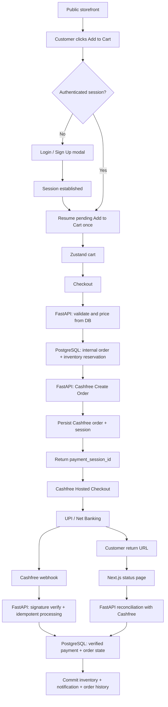

# Dridha Crafts — Cashfree Payment Gateway Implementation Plan

**Project:** Dridha Crafts e-commerce website  
**Document purpose:** Step-by-step implementation plan and operating instructions for the AI coding editor  
**Initial payment scope:** Cashfree Hosted Checkout for **UPI and Net Banking only**  
**Architecture:** Next.js 16 / React 19 / TypeScript → FastAPI → Cashfree Payments → Supabase PostgreSQL  
**Execution model:** One phase at a time; review and test each phase before proceeding

---

## 0. Executive summary and decisions

This plan takes the current Dridha Crafts application as its starting point. The latest readiness report states that authenticated checkout, address ownership checks, inventory reservations, idempotency, dynamic product fetching, and the basic regression tests have been implemented. The AI editor must verify the current repository before making any further changes; it must not assume that the report is perfectly current or that all described changes are present in the working tree.

The objective is to launch a reliable online checkout in which a customer must sign in or sign up **when they first click Add to Cart**, and then pay through Cashfree using UPI or Net Banking.

### 0.1 Product and payment decisions

1. Browsing the storefront remains public. A customer may browse products, categories, product details, and prices without signing in.
2. **Add to Cart is authentication-gated.** If a customer is not authenticated when they click Add to Cart, open the existing authentication modal. After successful authentication, complete the original Add to Cart action exactly once, preserving the selected product, variant, and quantity.
3. Checkout and order-creation APIs remain protected by Supabase authentication. The backend remains the security boundary; frontend guards are for user experience only.
4. The initial Cashfree online payment methods are **UPI and Net Banking only**. Do not add card, wallet, EMI, BNPL, or other payment modes to this release.
5. Do not expose direct/manual UPI or COD as payment choices in the initial customer checkout unless the business explicitly changes this decision. Preserve existing historical records and legacy backend/admin code; do not delete or rewrite it as part of this integration.
6. Use Cashfree Hosted Checkout with the Cashfree JavaScript SDK. Do not build a custom payment form and do not handle UPI PINs, bank credentials, card data, or other payment secrets in Dridha Crafts.
7. The backend calculates every payable amount using trusted database data. The browser never supplies an authoritative amount or payment status.
8. A customer return/redirect is not proof of payment. The order is considered paid only after server-side verification through Cashfree and/or a valid, signature-verified webhook, with the state transition applied idempotently.
9. Inventory must not be released just because a local timer elapsed. Expiry processing must reconcile Cashfree payment state before releasing an online reservation.
10. Existing storefront styling, animations, URLs, working product interactions, customer records, order history, and database data must be preserved.

### 0.2 Out of scope for this release

- Card payments.
- Wallets, EMI, BNPL, and other Cashfree payment methods.
- Cash on Delivery and customer-submitted manual UPI/Google Pay as new checkout methods.
- Guest checkout.
- Subscriptions or recurring payments.
- Split settlements or marketplace payouts.
- Automated partial refunds, refund dashboards, and dispute management. Preserve data model extensibility, but do not build refund operations unless separately approved.
- Rebuilding the storefront or replacing the existing state-management framework.
- Adding Redis, Celery, Kafka, a microservice, or another backend framework.
- Bundle checkout unless the existing backend already supports bundle pricing and bundle inventory correctly. If unsupported, prevent unsupported bundle items from entering payable checkout and document the limitation rather than inventing bundle rules.

---

## 1. Current architecture and baseline to preserve

The repository is expected to contain:

### Frontend (`frontend/`)

- Next.js 16 App Router, React 19, TypeScript, Tailwind CSS.
- Supabase client authentication and an `AuthProvider` mounted in the application layout.
- Zustand stores for authentication and cart state.
- A frontend API client that attaches the current Supabase access token to protected FastAPI requests.
- API-backed product fetching introduced during readiness work, with presentation assets retained locally where appropriate.
- Checkout page with a protected checkout flow and Cashfree/online payment not yet activated.

### Backend (`backend/`)

- FastAPI, Pydantic v2, SQLAlchemy 2 async, asyncpg.
- Supabase JWT validation and current-user dependencies.
- Product, cart, address, and order routers.
- Order creation with server-side pricing, inventory reservation, row locking, and checkout idempotency.
- Reservation expiry service/worker and protected expiry endpoint.
- Resend configuration may exist, but transactional email implementation must be checked rather than assumed.

### Database (`supabase/migrations/`)

- Existing catalog, user, address, cart, order, order-item, and inventory-reservation structures.
- Existing readiness migrations (reported as `002_cashfree_readiness.sql` and `003_idempotency_hash.sql`).
- New payment tables will be introduced in a later migration after auditing the actual deployed schema and migration history.

### Non-negotiable baseline rule

Before editing, inspect the actual branch, `git status`, latest commit, modified files, migration files, and current test configuration. Create a dedicated feature branch and a clean checkpoint commit if the repository is not already clean. Never overwrite or amend the baseline commit. If the working tree contains uncommitted user work, stop and report it; do not discard it.

---

## 2. End-to-end customer and payment journey

The desired customer journey is:

1. Customer browses the public storefront.
2. Customer selects product, variant (if applicable), and quantity.
3. Customer clicks **Add to Cart**.
4. If authenticated, add the selected item to the cart.
5. If not authenticated, open the existing Login/Sign Up modal. Preserve the pending add-to-cart intent.
6. After a valid authenticated session is established, add that exact product/variant/quantity to the cart once. If sign-up requires email confirmation and there is no active session yet, do not add the item until the customer completes sign-in.
7. Customer reviews cart and proceeds to checkout.
8. Customer provides/selects a shipping address and confirms contact details.
9. Frontend sends item identifiers, quantities, shipping-address data/reference, and an idempotency key to FastAPI. It does not submit a trusted price or total.
10. FastAPI validates user, products, variants, active status, quantity, stock, address ownership, discounts/shipping rules, and calculates the amount.
11. FastAPI creates the internal order and stock reservations transactionally, then creates or reuses the associated Cashfree payment order/session safely.
12. FastAPI returns only the data needed by the authenticated owner to launch Checkout, including the `payment_session_id` and an internal order reference.
13. Next.js initializes the Cashfree JS SDK in the configured environment and opens Hosted Checkout.
14. Customer chooses UPI or Net Banking and completes or abandons payment on Cashfree.
15. Cashfree calls the public FastAPI webhook endpoint. FastAPI verifies the signature using the original raw body, records the event, reconciles the payment, and updates order/payment/reservation state idempotently.
16. Cashfree redirects the customer to the Dridha Crafts return page. The page asks FastAPI for the current order/payment status; it never decides success from URL parameters.
17. If the webhook is delayed, FastAPI retrieves the payment status from Cashfree server-to-server and applies the same validation and state-transition service.
18. Once payment is verified and the database transaction commits, the order is confirmed, reservation is committed, cart is cleared for the customer, and transactional notifications are dispatched.
19. The customer can view the order in order history. The seller/admin receives an order/payment notification.

### Simplified architecture



---

## 3. Implementation phases

Implement phases in order. Each phase has an explicit scope, expected files, safety rules, and exit criteria. Do not start the next phase until the current phase is reviewed and its exit criteria pass.

# Phase 0 — Repository, environment, and Cashfree account preparation

### Objectives

Establish a safe implementation baseline, verify the actual readiness state, and prepare Cashfree Sandbox credentials without writing payment code.

### Tasks

1. Inspect the actual repository structure and branch.
2. Run `git status` and record all modified/untracked files. Do not discard anything.
3. Record the current commit hash and create a dedicated feature branch/checkpoint commit after user work is safely committed.
4. Inspect and confirm the actual state of:
   - Supabase `AuthProvider`, `AuthModal`, and `useAuthStore`.
   - Frontend `api.ts` JWT injection.
   - All Add to Cart call sites.
   - Checkout and order creation flow.
   - Inventory reservation model/service/expiry worker.
   - Existing order, payment, and reservation states.
   - Migrations `001`, `002`, and `003`, plus actual migration history.
   - Backend and frontend test commands.
5. Confirm that automated tests use an isolated development/test database, not production.
6. Create or access the Cashfree merchant account and Sandbox credentials.
7. Confirm the merchant website domain, backend public URL strategy, and webhook URL strategy. A local webhook test may use a secure tunnel, but production needs a stable public HTTPS URL.
8. Check Cashfree merchant dashboard configuration and verify that UPI and Net Banking are activated for the merchant account.
9. Do not enable production credentials or collect a live payment in this phase.

### Environment variables

Use the existing settings conventions. Names below are suggestions; reuse existing names if the project already has a consistent convention.

Backend-only secrets/configuration:

- `CASHFREE_CLIENT_ID`
- `CASHFREE_CLIENT_SECRET`
- `CASHFREE_ENVIRONMENT` (`sandbox` or `production`)
- `CASHFREE_API_VERSION` (explicitly pinned and tested)
- `CASHFREE_WEBHOOK_SECRET` only if the current Cashfree setup uses a distinct webhook secret; verify Cashfree's current signing instructions rather than assuming it differs from the API secret.
- `CASHFREE_RETURN_URL`
- `CASHFREE_NOTIFY_URL`
- `CRON_SECRET` (must be set to a strong, non-default production value)

Rules:

- Never prefix secrets with `NEXT_PUBLIC_`.
- Never return Client Secret, webhook secret, or other private credentials to the browser.
- Do not print secret values in logs, audit output, screenshots, or terminal transcripts.
- Use separate Sandbox and Production credentials.
- Fail startup or payment initiation safely if required production values are missing; do not silently fall back to Sandbox or a weak default.

### Exit criteria

- Clean, recoverable Git baseline exists.
- Test DB isolation is confirmed.
- Cashfree Sandbox account/credentials are available securely.
- Current API and webhook versions are documented and pinned for the implementation.
- UPI and Net Banking activation is confirmed or a merchant-side blocker is documented.

---

# Phase 1 — Add-to-Cart authentication gate

### Objective

When an unauthenticated visitor clicks any Add to Cart control, prompt for Login/Sign Up. After successful authentication, resume the original action exactly once without losing the selected product, variant, or quantity.

### Required user experience

**Authenticated customer:** click Add to Cart → item is added immediately → existing cart feedback/toast appears.

**Unauthenticated customer:** click Add to Cart → login/signup modal opens → customer authenticates → original item is added once → modal closes → existing success feedback appears.

**Sign-up requires email confirmation:** do not assume a session exists. Show the existing confirmation/login guidance. Resume the pending add-to-cart only after Supabase reports a valid authenticated session.

### Implementation tasks

1. Search the entire frontend for all Add to Cart actions, including:
   - Product detail page.
   - Shop/product cards and quick-add controls.
   - Homepage featured product cards.
   - Any related/bundle or recommendation components that currently add products.
2. Identify one reusable auth-gated add-to-cart mechanism (a hook, helper, or controlled provider action) rather than duplicating slightly different logic in every component.
3. The pending action must contain only the required product selection data:
   - Real database `product_id`.
   - Real `variant_id`, if selected.
   - Quantity.
   - Any other minimal cart selection identifier already required by the current cart model.
4. If the customer is authenticated, call the existing cart-store action directly.
5. If not authenticated:
   - Store the pending add-to-cart action in safe in-memory application state.
   - Open the existing `AuthModal` in Login/Sign Up mode.
   - Do not add the item before authentication.
6. On a confirmed Supabase authenticated session:
   - Execute the pending action exactly once.
   - Clear the pending action immediately after successful execution.
   - Prevent duplicate execution from repeated `onAuthStateChange` events, React rerenders, or repeated button clicks.
7. On modal close, failed login, or sign-up without an active session, do not add the item. Clear or retain the pending action according to a clear user-friendly policy; do not silently add later after an unrelated future login.
8. Preserve selected variant and quantity through authentication. Do not default a selected variant to `null`.
9. Handle AuthProvider initialization/loading state correctly. Do not show the login modal merely because Supabase session hydration has not completed yet.
10. Handle logout/account switching safely so one customer's persisted cart is not silently exposed to another customer using the same browser. Review the current Zustand persistence strategy and use the least disruptive account-scoping or clearing policy.
11. Do not require authentication for public browsing, product detail viewing, or other pages unless existing product requirements already require it.
12. Do not change checkout/backend authentication semantics in this phase beyond verifying that they remain protected.

### Suggested acceptance tests

- Guest clicks Add to Cart on a simple product: modal opens; item is not yet in cart.
- Guest selects a variant and quantity 2, signs in: correct variant and quantity 2 are added exactly once.
- Guest signs up and receives no immediate session: item is not added until a valid session exists.
- Login failure: item is not added.
- Modal closed: item is not added.
- Repeated auth-state events: item is not duplicated.
- Authenticated user clicks Add to Cart: item is added without opening modal.
- Logout and another user logs in: cart from prior account is not unintentionally shown.
- All existing storefront product interactions and styling still work.

### Likely files to inspect

- `frontend/src/components/providers/AuthProvider.tsx`
- `frontend/src/components/auth/AuthModal.tsx`
- `frontend/src/stores/authStore.ts`
- `frontend/src/stores/cartStore.ts`
- `frontend/src/app/products/[slug]/page.tsx`
- `frontend/src/app/shop/page.tsx`
- `frontend/src/app/page.tsx`
- Product card / quick-add components discovered by search

Do not assume these are the only affected files. Trace all actual Add to Cart references.

### Exit criteria

All Add to Cart paths enforce the same authentication behavior, the pending action resumes once after login, and frontend build/tests pass without changing the public browsing experience.

---

# Phase 2 — Checkout contract and online-only method scope

### Objective

Make the checkout request and payment choices unambiguous before connecting to Cashfree.

### Tasks

1. Inspect the current cart representation and checkout payload.
2. Ensure checkout sends only identifiers/quantities and trusted address references or validated inline address data. It must not send an authoritative unit price, subtotal, tax, discount, shipping amount, or final amount.
3. Backend validates authenticated user, address ownership, active products, variants, stock, variant-specific price, and any supported discount/shipping logic.
4. Confirm the business pricing policy:
   - Are product prices inclusive of GST?
   - Is shipping free for all orders or threshold-based?
   - Are discounts/coupons in scope?
   - If tax/shipping is not configured, preserve the existing explicit policy; do not invent or silently add charges.
5. Ensure online checkout is a single Cashfree payment flow, not a manual UPI/UTR workflow.
6. Initial customer-visible online methods must be UPI and Net Banking only.
7. Do not display Card, Wallet, EMI, BNPL, or other modes as supported.
8. Preserve COD/manual payment backend records and admin history, but do not expose out-of-scope choices in the customer checkout for this release unless the business explicitly approves them.
9. Define the checkout behavior for unsupported bundles. Do not accept a bundle into payment checkout unless backend pricing, component stock reservation, and order-item snapshots are correct.
10. Keep the cart when session creation fails, Cashfree rejects order creation, or the customer abandons payment. Clear it only after the backend confirms successful payment and the order is finalized (or according to an explicitly approved cart/order policy).

### Exit criteria

Checkout payload contains no trusted client price; backend pricing rules are documented; only approved payment choices are visible; unsupported catalog items cannot be paid for accidentally.

---

# Phase 3 — Payment database schema and SQLAlchemy models

### Objective

Add durable payment records without overloading the existing `orders` table or breaking existing order history.

### Required logical model

```text
orders (existing business order)
   |
   | 1-to-many
   v
payments (one Cashfree order/session per record)
   |
   | 1-to-many
   v
payment_attempts (individual provider payment transactions)
   |
   | 1-to-many / linked events
   v
payment_events (webhook/event audit records)
```

### Table A: `payments`

One row represents one Cashfree order/session associated with an internal Dridha Crafts order.

Recommended fields (adapt naming and types to existing conventions):

- `id` UUID primary key.
- `order_id` UUID FK to `orders.id`, `ON DELETE RESTRICT`.
- `gateway` (e.g. `cashfree`).
- `environment` (`sandbox` / `production`).
- `merchant_order_id` — unique ID generated by Dridha Crafts and sent to Cashfree.
- `cf_order_id` — Cashfree-generated order ID; unique per gateway when non-null.
- `payment_session_id` — protected session token required by the frontend to open Checkout.
- `amount` NUMERIC(10,2) or precision aligned with the existing order total.
- `currency` CHAR(3), initially `INR`.
- `status` — normalized local state such as `initiating`, `active`, `paid`, `expired`, `failed`, `terminated`, `initiation_failed`; choose a controlled enum/CHECK constraint.
- `idempotency_key` used for Cashfree Create Order API retries, UUID-compatible where required.
- `expires_at`, `created_at`, `updated_at`.

Constraints/indexes:

- Unique `(gateway, merchant_order_id)`.
- Unique `(gateway, cf_order_id)` where `cf_order_id IS NOT NULL`.
- Index `order_id`.
- Restrict deletes for financial records; do not cascade-delete them with an order.
- Never expose `payment_session_id` through generic order-history APIs. Return it only from the authenticated create/reuse-session endpoint to the owning customer.

### Table B: `payment_attempts`

One row represents an actual Cashfree payment attempt/transaction.

Recommended fields:

- `id` UUID primary key.
- `payment_id` UUID FK to `payments.id`, `ON DELETE RESTRICT`.
- `cf_payment_id` unique per gateway when present.
- normalized `payment_status` plus provider status value where helpful.
- `payment_amount` NUMERIC(10,2).
- `currency`.
- `payment_method` — expected normalized `upi` or `netbanking`; preserve provider method details where useful.
- `bank_reference` or bank transaction reference when supplied.
- `payment_message`, `error_code`, `error_message` where supplied.
- `payment_time`, `payment_completed_at`, `created_at`, `updated_at`.

Constraints/indexes:

- Unique `(gateway, cf_payment_id)` if `gateway` is stored on this table; otherwise ensure uniqueness across the associated provider/payment records with an appropriate design.
- Index `payment_id`.
- Do not overwrite a failed attempt with a later successful attempt; retain each distinct provider transaction.

### Table C: `payment_events`

Append-only record of incoming webhook events and their processing history.

Recommended fields:

- `id` UUID primary key.
- `payment_id` FK, nullable only if event correlation has not yet succeeded; consider storing a provider order reference for later reconciliation.
- `payment_attempt_id` FK, nullable until the event is correlated.
- `gateway`.
- `event_type`.
- `webhook_version` / configured event version where available.
- provider event identifier if the selected webhook schema reliably exposes one.
- `payload_hash` SHA-256 of the exact raw request bytes as an additional duplicate-event fingerprint.
- `signature_verified` boolean.
- `processing_status` (`received`, `processed`, `failed`, etc.).
- `payload` JSONB only if retention is justified; minimize/redact PII and never store secrets.
- `received_at`, `processed_at`, `error_message`.

Important:

- Do not assume a webhook has a unique provider event ID unless the selected Cashfree webhook version documents it.
- Do not use `cf_payment_id` alone as the unique key for webhook events: one payment attempt can generate multiple status events.
- Deduplicate transaction processing using the payment ID and state-transition rules; use event IDs or event fingerprints for event storage deduplication.
- Verify the signature against the original raw bytes before parsing JSON.

### Existing table changes

Inspect the actual latest schema first. Do not duplicate columns already added by migrations `002` or `003`.

- Keep `orders` as the business-order record.
- Add only provider-neutral fields that are truly required and missing. Do not store all Cashfree identifiers on `orders` if they belong in `payments`.
- Keep separate order lifecycle and payment lifecycle fields.
- Preserve `order_items.variant_id` and inventory reservation links already introduced.
- Use positive-amount and status CHECK constraints where compatible with current data.
- Ensure financial tables have RLS enabled and no permissive public/anonymous policies. Backend access must use the intended secure database role.

### Migration rules

1. Inspect actual database schema and migration history before generating SQL.
2. Resolve the previous `001`/`002`/`003` migration-history inconsistency safely before adding a new migration.
3. Do not rewrite historical migration files already applied to a database.
4. Create one new versioned migration using the project's authoritative migration system.
5. Test on an isolated development database first.
6. Compare SQL DDL, SQLAlchemy models, indexes, foreign keys, and constraints after migration.
7. Do not run a migration against production without explicit human approval and a backup/rollback plan.

### Exit criteria

Payment tables and ORM models match; foreign keys/indexes/constraints are verified; migration state is consistent; no existing order/cart/catalog data is changed or lost.

---

# Phase 4 — Cashfree Sandbox configuration and method restriction

### Objective

Prepare a backend-only Cashfree client configuration and prove that the merchant account can display only UPI and Net Banking in the initial Checkout experience.

### Tasks

1. Configure Sandbox App ID and Secret Key in backend environment settings.
2. Select and pin a Cashfree API version based on the current official API reference. Do not rely on a moving default without recording the selected version.
3. Configure Sandbox/Production base URL using one centralized environment setting; do not duplicate URLs throughout the code.
4. Configure frontend SDK environment from a safe public mode value only (`sandbox` or `production`); never expose credentials.
5. Verify the website domain whitelisting requirement and configure the appropriate Sandbox/production domains in Cashfree Dashboard.
6. Confirm UPI and Net Banking are activated for the merchant account.
7. Restrict the Hosted Checkout methods to UPI and Net Banking:
   - Review Cashfree Merchant Dashboard payment-method settings.
   - Review the current Create Order API `order_meta.payment_methods` capability for the exact API version selected.
   - Verify the exact documented method identifiers and syntax from the current Cashfree docs or Cashfree support. **Do not guess values such as `upi`, `nb`, or `netbanking`.**
   - Apply merchant dashboard restrictions and/or the documented order-level allowlist as appropriate.
   - Verify the actual rendered Sandbox Hosted Checkout UI shows UPI and Net Banking only. A frontend label or hidden radio button is not sufficient to restrict gateway methods.
8. If Cashfree does not allow this restriction in the selected configuration, stop and report the merchant-side/configuration requirement before coding an unsupported filter.
9. Configure backend public webhook URL and customer return URL.
10. Keep the API client timeout, retry policy, and safe error logging centralized.

### Exit criteria

Backend can reach Cashfree Sandbox; credentials remain server-side; selected API version is pinned; domain and webhook configuration are ready; a sandbox checkout visibly offers only UPI and Net Banking.

---

# Phase 5 — FastAPI Cashfree order/session creation

### Objective

Create a Cashfree order from a server-validated internal order and safely return the `payment_session_id` to the authenticated frontend.

### Recommended service separation

Follow existing backend patterns. A likely organization is:

- `backend/app/services/cashfree.py` — Cashfree HTTP client and API operations.
- `backend/app/routers/payments.py` — authenticated customer payment endpoints and public webhook endpoint (or separate routers if current conventions require).
- `backend/app/models/payment.py` — payment models, if models are currently organized by domain.
- `backend/app/schemas/payment.py` — request/response schemas.

Do not create these exact files if equivalent modules already exist. Reuse existing service/router conventions.

### Recommended customer endpoint

A single orchestration endpoint is preferable, for example:

`POST /api/payments/checkout`

It should:

1. Require an authenticated Supabase user.
2. Validate the request schema and internal idempotency key.
3. Reuse the existing trusted order/pricing/inventory service; do not duplicate it in a second order-creation implementation.
4. Validate product IDs, variant IDs, quantities, active status, stock, saved-address ownership, and supported cart contents.
5. Recompute totals from the database using Decimal/Numeric arithmetic. Never trust a browser-supplied amount.
6. Create the internal order and inventory reservations in one short database transaction.
7. Create/prepare a local `payments` row with a unique `merchant_order_id` and local idempotency key in a durable transaction.
8. Commit the database transaction **before** calling Cashfree. Do not hold database row locks open during external network calls.
9. Call Cashfree Create Order API using:
   - `order_amount` calculated by the backend, with at most two decimal places.
   - `order_currency = INR`.
   - A unique `order_id`/merchant order ID compatible with Cashfree's documented format and length.
   - customer ID/name/email/phone from trusted user/order snapshots.
   - a return URL pointing to the Dridha Crafts payment-status route.
   - a notification URL for the FastAPI webhook.
   - an order expiry aligned with the internal reservation policy.
   - UPI/Net Banking only, using the exact documented method restriction confirmed in Phase 4.
10. Use Cashfree's documented API idempotency header for safe retries of the same Create Order request, with the same key and same request semantics. Do not generate a new Cashfree order ID for a network retry of the same request.
11. Persist Cashfree's `cf_order_id`, `payment_session_id`, order status, expiry and relevant response metadata. Do not log the session token.
12. Return a minimal response to the authenticated order owner, e.g. internal order reference, payment record reference, `payment_session_id`, and environment/mode as needed by the SDK.
13. If Cashfree rejects order creation, record the initiation failure and handle the reservation/order state deliberately. Do not leave a silently payable/unpayable order or release stock while the gateway outcome is unknown.
14. If the Cashfree Create Order request times out and the outcome is unknown, retry/reconcile using the same Cashfree request idempotency identity. Do not create a duplicate provider order.
15. A repeated checkout request with the same internal idempotency key and same payload should return/reuse the existing order/session where safe. A reused key with a different payload should return HTTP 409.

### Payment retry semantics

- A payment attempt within the same Cashfree order may produce distinct `cf_payment_id` transactions. Track each transaction separately.
- Reuse an active Cashfree order/session while it remains valid and appropriate.
- If the Cashfree order has definitively expired/terminated and a new checkout is allowed, create a new local `payments` record with a new `merchant_order_id` and a new Cashfree order. Keep the original internal business order or create a new internal order according to the chosen order lifecycle; document and test the policy.
- Do not overwrite a previous transaction or reuse an expired `payment_session_id`.

### Exit criteria

Authenticated backend can create and persist a Cashfree Sandbox order/session; duplicate requests are safe; amount and customer data are server-derived; API timeouts/errors produce recoverable internal states.

---

# Phase 6 — Next.js Cashfree Hosted Checkout

### Objective

Open Cashfree Hosted Checkout using the session ID returned by FastAPI.

### Tasks

1. Install the official Cashfree JS SDK package only after checking its current official documentation and compatibility with the installed Next.js/React version.
2. Pin a compatible package version in the package manifest/lockfile. Do not install a random/unverified package or copy old SDK examples blindly.
3. Load and initialize the SDK client-side only; protect code from Next.js server rendering/browser-global errors.
4. Select sandbox vs production mode from a safe public setting matching the backend environment. Never expose API secrets.
5. On Pay Now:
   - prevent duplicate clicks while the request is in progress;
   - call the authenticated FastAPI checkout/session endpoint;
   - receive the payment session ID;
   - launch Cashfree checkout using the documented current SDK method and redirect mode.
6. Use Hosted Checkout redirect flow unless there is a compelling reason and explicit approval to use popup/inline flow.
7. Handle SDK initialization failures, blocked popup/redirect, missing session ID, API errors, and customer cancellation gracefully.
8. Do not mark the order paid or clear the cart based on the SDK callback/redirect alone.
9. Ensure payment-method selection in the customer UI matches the Cashfree configuration. Do not present a UPI/netbanking selector that falsely implies the browser can enforce the gateway allowlist.
10. Keep the cart and order details available for retry/status checking until the backend reports the final successful payment state.

### Exit criteria

A logged-in customer can open Sandbox Hosted Checkout for a server-created order. The UI displays only UPI and Net Banking. No secret is exposed in browser source, network requests, or frontend environment variables.

---

# Phase 7 — Cashfree webhook verification and payment processing

### Objective

Use Cashfree's server-to-server webhook as a durable payment notification channel and apply verified updates safely.

### Endpoint requirements

Create a public HTTPS endpoint such as:

`POST /api/payments/cashfree/webhook`

It must not require Supabase customer JWT authentication. It must instead validate Cashfree's webhook signature exactly as documented for the selected webhook version.

### Processing sequence

1. Read the original request body as raw bytes using FastAPI's request body API before JSON parsing.
2. Extract the exact Cashfree webhook headers (including signature and timestamp) documented for the selected webhook version.
3. Verify the signature using the official algorithm and the correct secret. Do not parse/re-serialize JSON before verification.
4. Do not invent an arbitrary timestamp tolerance. Follow current Cashfree replay/freshness guidance for the configured webhook version and account.
5. If signature validation fails, do not update orders, payments, attempts or inventory.
6. Persist a verified event or a safe invalid-event audit record according to the retention policy. Do not store secrets or unnecessary sensitive data.
7. Correlate the event to a local payment record using the merchant/Cashfree order reference and, where present, the `cf_payment_id`.
8. Lock the relevant internal order/payment rows when applying state transitions.
9. Validate:
   - merchant order ID and Cashfree order ID match the stored payment record;
   - internal order/customer relationship is correct;
   - amount matches the expected payment/order amount;
   - currency is INR;
   - the event references the expected payment transaction;
   - the payment method is UPI or Net Banking for this release.
10. Insert or update the corresponding `payment_attempts` record while retaining distinct attempts.
11. Make event handling idempotent. Duplicate notifications must not double-confirm an order, commit inventory twice, clear carts twice, or send duplicate emails.
12. Handle event ordering carefully. A stale pending/failed event must not downgrade an already verified successful payment. Define legal state transitions explicitly and keep the provider's raw status for diagnostics.
13. Treat pending/unknown states as pending, not as failure.
14. Only verified successful payment can transition the order to paid/confirmed and commit its stock reservation.
15. Commit all database changes in one short transaction.
16. Dispatch email/notification work after commit, ideally through a durable outbox or an idempotent post-commit job.
17. Return the appropriate success HTTP response only after the event has been durably recorded/processed according to the retry strategy. If persistence fails, return an error so the provider can retry; do not falsely acknowledge lost payment events.
18. Keep webhook logs free of credentials, session tokens, full bank details, and unneeded PII.

### Webhook event tests

- Valid success event.
- Invalid signature.
- Wrong/missing headers.
- Duplicate success event.
- Pending then success.
- Failed attempt followed by successful attempt.
- Late/stale event after a newer terminal success.
- Wrong amount/currency/order mapping.
- Unknown Cashfree order ID.
- Database transaction failure and provider retry.

### Exit criteria

Webhook signature verification uses raw bytes; valid events update payment records once; invalid/duplicate/out-of-order events cannot corrupt order state or inventory; webhook failures are retryable and observable.

---

# Phase 8 — Return page, status reconciliation, and expiry coordination

### Objective

Make the customer return experience reliable even when the webhook is delayed, missing temporarily, or delivered after the browser returns.

### Tasks

1. Configure Cashfree `return_url` to a dedicated Dridha Crafts status page, for example `/checkout/payment-status`.
2. Treat query parameters as untrusted routing/reference hints only. Do not interpret a browser `status=success` parameter as payment proof.
3. The frontend calls an authenticated FastAPI endpoint for the current user's order/payment status.
4. FastAPI looks up the internal payment record and checks ownership.
5. If the database already contains a verified successful payment, return the verified order status.
6. If status is pending/unknown and enough time has elapsed, FastAPI queries Cashfree's server-side Get Payments for an Order endpoint and reconciles all attempts.
7. Apply the exact same amount/currency/order/status validation and idempotent state transition service used by the webhook. Avoid implementing a second divergent payment-update path.
8. Poll with bounded retries and backoff; stop polling on terminal states and show a clear pending message when still unresolved.
9. Do not let the browser call Cashfree with Client Secret.
10. Preserve the cart until backend-confirmed successful payment. On confirmed success, clear only the relevant customer's cart/order contents without affecting another session.
11. Update the existing reservation expiry service:
    - distinguish Cashfree-backed online orders from manual UPI/COD historical flows;
    - before releasing an online reservation, query/reconcile the provider order if the payment outcome may be uncertain;
    - do not release stock for a pending or unknown payment merely because the local clock reached `expires_at`;
    - release only when payment is definitively unsuccessful/expired and the policy permits release;
    - prevent the expiry worker and webhook from racing into contradictory state transitions.
12. Align Cashfree `order_expiry_time` with the local reservation expiry and include a safe reconciliation buffer/policy. Do not assume the provider and application clocks/events are perfectly synchronized.
13. If a payment succeeds after stock was already released/cancelled, flag an exceptional state for admin review/refund. Do not automatically ship if inventory is no longer reserved/available.
14. Review the current in-process FastAPI expiry worker. In multi-worker/multi-replica deployments, prevent duplicate worker behavior using a singleton external scheduler or database-safe job claiming/locking. Do not run competing scheduler setups accidentally.
15. Production `CRON_SECRET` must be strong, explicitly configured, and have no predictable default. Do not expose it to the frontend.

### Exit criteria

A customer sees accurate pending/success/failure outcomes; the backend reconciles delayed webhooks; inventory expiry cannot release stock for a potentially successful payment; late success becomes a controlled exception.

---

# Phase 9 — Customer receipt, invoice, and seller notification

### Objective

Complete the order communication workflow after verified payment.

### Tasks

1. Inspect current Resend implementation. Do not assume it exists just because the dependency/environment variable exists.
2. Create/reuse a backend email service following current project conventions.
3. Trigger customer payment/order confirmation only after the successful payment and order update transaction commits.
4. Send the seller/admin a new paid-order notification containing order number, items, quantities, shipping details needed for fulfillment, amount, and payment reference; do not include secrets or sensitive bank credentials.
5. Send the customer a payment receipt and invoice/receipt attachment or a secure link, according to the business's invoice requirements.
6. Use order-item snapshots and order/customer snapshots, not current catalog prices, to render historical receipt details.
7. Determine whether the business requires a GST tax invoice or a payment/order receipt. Do not invent GSTIN, tax rates, invoice number policy, legal entity name, or address. Obtain correct merchant details and tax treatment from the business/accountant before labeling a document a GST invoice.
8. Prevent duplicate emails when the same webhook is delivered multiple times or the return-page reconciliation and webhook both observe success.
9. Prefer a database outbox or an equivalent durable idempotent notification record so a transient Resend failure can be retried without resending duplicates.
10. Email failure must not roll back a successful payment/order confirmation. Record and retry notification failure separately.

### Exit criteria

Verified successful payment generates one customer confirmation/receipt and one seller notification; failed/pending payment sends no paid confirmation; duplicate events do not duplicate emails.

---

# Phase 10 — Sandbox end-to-end testing

### Required test matrix

| Scenario | Expected result |
|---|---|
| Guest clicks Add to Cart | Login/Sign Up opens; item is not added yet |
| Guest logs in successfully | Original selected item/variant/quantity is added exactly once |
| Sign-up needs email confirmation | Item is not added until a valid session exists |
| Authenticated customer adds product | Added immediately without modal |
| Customer uses another user's address ID | Backend rejects it |
| Customer changes browser price/total | Backend ignores it and calculates from DB |
| Product/variant inactive or out of stock | Checkout rejected safely; no payment session created |
| Customer double-clicks checkout | One internal order/payment initiation only |
| Same idempotency key with changed payload | HTTP 409; no second order |
| Cashfree Create Order succeeds | Local payment session record maps to provider order and internal order |
| Cashfree API times out | Same provider idempotency identity is reused/reconciled; no duplicate payment order |
| Sandbox UPI succeeds | Verified by webhook/API; order paid; stock committed; emails dispatched once |
| Sandbox Net Banking succeeds | Same successful lifecycle |
| UPI/Net Banking fails | Payment attempt failed; order remains retryable or expires according to policy; no false confirmation |
| Customer abandons checkout | No false paid state; reservation expires only after reconciliation/policy |
| Payment remains pending | Show pending; do not release inventory prematurely |
| Webhook delayed | Return page reconciliation finds the actual provider state |
| Webhook delivered twice | One transaction/confirmation/stock commit/email |
| Invalid webhook signature | No financial or inventory state change |
| Webhook event arrives out of order | State cannot regress from verified success |
| Wrong amount/currency | Reject processing and flag for investigation |
| Payment succeeds after cancellation/release | Exception/manual review/refund path; no automatic fulfillment |
| User closes browser after paying | Webhook still updates backend order; customer can see status later |
| UPI/Net Banking only restriction | Actual Cashfree Hosted Checkout exposes no card/wallet/EMI options |
| Existing COD/manual-payment historical/admin workflow | No regression or data loss; out-of-scope choices are not displayed in new checkout |

### Testing rules

- Use Cashfree Sandbox credentials and provider test flows only.
- Never use real customer bank details or a live payment to test.
- Use an isolated development/test database.
- Do not delete real orders or products to create test conditions.
- Test concurrency against PostgreSQL, not SQLite.
- Record failing test output and fix root causes; do not weaken/remove assertions to obtain a green build.
- Run backend tests, frontend type-check, lint (if configured), and production build after each major integration phase.
- Test webhook delivery through a public secure tunnel during local development; never expose an unauthenticated unverified payment endpoint as a substitute.

### Exit criteria

All relevant test cases pass in Sandbox; payment events are durable and idempotent; inventory and order states are correct under failures/retries; actual checkout exposes only UPI and Net Banking.

---

# Phase 11 — Production readiness and go-live

### Prerequisites

1. Cashfree production account/business verification and payment-method activation are complete.
2. Production App ID and Secret Key are generated and stored only in backend secret management.
3. Production website domain is HTTPS and whitelisted as required by Cashfree.
4. Production API base URL and API version are explicitly configured.
5. Production webhook URL is public HTTPS and configured for the tested webhook event version.
6. Webhook signature verification is confirmed using the production configuration procedure without exposing secrets.
7. Production `CRON_SECRET` is strong and required; no default is permitted.
8. Reservation expiry and reconciliation worker has a reliable single-instance/claiming strategy.
9. Database migration history is consistent and backed up; migration and rollback procedure documented.
10. RLS, backend database role permissions, CORS, JWT verification, and API rate limits are reviewed.
11. Order/customer email, invoice/receipt content, merchant identity, tax treatment, support contact, shipping/return/refund policies, and customer-facing terms are accurate.
12. Resend sender domain is configured/verified and email delivery tested.
13. Production monitoring/logging excludes credentials, session tokens, UPI PINs, bank secrets, and unnecessary personal data.
14. Admin has an operational process for checking orders, handling payment exceptions, late payment success, cancellations, returns, and refunds.
15. Run a controlled production smoke test with a small authorized real transaction only after explicit business approval. Verify settlement in Cashfree Dashboard and reconciliation with the internal order record.

### Go-live switch

- Use explicit environment configuration to select Sandbox or Production.
- Do not allow a frontend mode flag to override backend credentials/environment.
- Never mix Sandbox credentials with Production endpoints or vice versa.
- Initially enable only UPI and Net Banking in Cashfree settings and verify the actual production Hosted Checkout page.
- Keep a documented rollback plan to disable new online checkout initiation while preserving read access to already-created orders/payment records.

### Exit criteria

The business has completed Cashfree approval and production configuration; all technical and operational checks pass; a controlled production transaction is reconciled correctly; the owner explicitly approves public launch.

---

## 4. Required API surface (proposed; reconcile with existing routes)

Do not create duplicate routes if equivalent functionality already exists. Use the project's existing `/api` conventions and response schemas.

| Endpoint | Auth | Responsibility |
|---|---|---|
| `POST /api/payments/checkout` | Supabase JWT | Validate/create or reuse internal order, create/reuse Cashfree order/session, return session ID |
| `GET /api/orders/{order_id}/payment-status` | Supabase JWT + ownership | Return backend-verified status; trigger bounded server-side reconciliation where appropriate |
| `POST /api/payments/cashfree/webhook` | No Supabase JWT; Cashfree signature required | Receive and process verified Cashfree events |
| Existing reservation-expiry endpoint | Admin or strong cron secret | Scheduled expiry/reconciliation job; preserve existing authorization policy |

### API contract rules

- The client cannot select an arbitrary `user_id` or internal order owner.
- The client cannot supply the authoritative amount/currency/payment status.
- The client cannot mark an order paid.
- Only the authenticated order owner or authorized admin can retrieve order/payment status.
- `payment_session_id` is returned only to the authenticated owner during the authorized session-creation flow.
- Never return Cashfree Client Secret or webhook secret.
- Validate all IDs and quantities with Pydantic schemas.
- Use Decimal/Numeric for currency arithmetic, not binary float calculations in business logic.
- Keep customer-facing responses free of provider stack traces and secret-bearing payloads.

---

## 5. Payment and order status design

Keep order fulfillment status separate from payment status.

### Suggested order lifecycle

- `payment_pending` — online payment has been initiated but not confirmed.
- `confirmed` — successful payment has been verified (or an explicitly supported alternative payment policy has been fulfilled).
- `processing` — order is being prepared.
- `shipped` — handed to courier.
- `delivered` — delivered.
- `cancelled` — cancelled under a defined policy.
- Any existing statuses retained for historical compatibility.

### Suggested internal payment lifecycle

Use normalized internal statuses, while retaining Cashfree's raw provider status for diagnostics:

- `initiating`
- `active`
- `pending`
- `success`
- `failed`
- `user_dropped`
- `expired`
- `terminated`
- `initiation_failed`
- `partially_refunded` / `refunded` only if refund support is added later

Do not copy provider statuses into application enums blindly. Map documented Cashfree values through one explicit mapping function.

### Transition rules

- Browser redirect alone never changes payment status to success.
- Verified Cashfree payment success is the only event that commits a Cashfree reservation and marks the order paid/confirmed.
- Pending is not failure.
- A failed attempt can be followed by another attempt; preserve both.
- A later stale failure/pending event cannot downgrade a verified success.
- A refund is a financial event, not proof that physical stock should be restored.
- Stock restoration requires an explicit inventory/return policy and idempotent reservation transition.

---

## 6. Security, data, and reliability rules for the AI editor

These rules apply to every phase.

### Architecture

1. FastAPI is the authority for price, stock, orders, payment state, and fulfillment transitions.
2. Cashfree secrets exist only in backend environment/secret storage.
3. Next.js only receives the payment session token required to open Checkout.
4. Supabase RLS is not a replacement for backend authorization; protect all customer-specific endpoints.
5. The Cashfree webhook is public but only trusted after signature validation.
6. Do not hold PostgreSQL row locks while calling external Cashfree or Resend APIs.
7. Use short database transactions and safe post-commit side effects.
8. Every provider callback, job, and retry must be idempotent.
9. Payment state changes and inventory reservation transitions must be committed atomically where they belong to the same database operation.
10. Use timeouts and bounded retries for external API calls. Never retry with a new idempotency identity if the original outcome is unknown.

### Frontend preservation

1. Do not replace the Zustand store or rewrite the entire cart.
2. Do not remove existing Framer Motion, GSAP, Three.js, Tailwind, or page layout code as part of payment work.
3. Preserve current routes/slugs and visual product assets.
4. Add the authentication gate through a shared, reusable path and audit every Add to Cart entry point.
5. Keep public browsing public.
6. Use the current AuthProvider/AuthModal; do not add a second authentication library or modal.
7. Do not duplicate API client logic or bypass JWT injection.
8. Avoid hydration errors and ensure browser-only SDK code runs only client-side.

### Backend preservation

1. Reuse the current order/pricing/inventory services; do not create a second conflicting order creation path.
2. Keep COD/manual-payment historical/admin handling unless explicitly approved for removal.
3. Do not weaken `get_current_user`, address ownership, admin, or RLS protections to make integration easier.
4. Keep the webhook route free of customer JWT dependency but require exact Cashfree signature verification.
5. Do not mark paid from a request body, query parameter, SDK callback, or frontend state.
6. Do not restore stock merely because an order's payment is refunded.
7. Do not delete payment/order records as part of cleanup.

### Database and migration

1. Inspect live/development schema and migration tracker before writing DDL.
2. Never modify an already-applied historical migration.
3. Never execute database migrations against production without explicit user approval.
4. Add forward-only migration scripts and document rollback strategy.
5. Add constraints/indexes deliberately; inspect existing data before constraints.
6. Use `ON DELETE RESTRICT` for financial records where appropriate.
7. Enable RLS for payment tables and do not add public read/write policies.
8. Do not store session tokens or raw payment payloads in unrestricted customer-readable tables.
9. Keep SQLAlchemy models and SQL migrations aligned.

### AI editor operating procedure

For each phase:

1. **Plan first:** List exact files to inspect and proposed files to modify. State the behavior that must remain unchanged.
2. **Wait for approval where the change affects database state, authentication policy, inventory behavior, payment methods, or production configuration.**
3. Make the smallest cohesive change. Avoid broad refactoring.
4. Keep changes within the current phase. Do not opportunistically fix unrelated lint/style issues.
5. After each logical change, run the narrowest relevant tests.
6. Inspect `git diff` and ensure no unrelated formatting or generated files changed.
7. Run full backend tests and frontend checks after the phase.
8. Report changed files, migrations, tests, results, failures, and manual dashboard/deployment steps.
9. Do not claim a test passed unless its command actually completed with exit code 0.
10. Do not say “production ready” based only on a successful build or mocked tests.
11. If a requirement is ambiguous or the Cashfree docs do not confirm a parameter/value, stop and report the ambiguity rather than guessing.
12. Never silently weaken a test or remove an assertion to achieve a green test suite.

### Stop conditions

Stop and report instead of improvising if:

- The current working tree has user changes that are not committed.
- The actual database migration state is unclear.
- The target test database may be production.
- The selected Cashfree API/webhook version is not known.
- The exact UPI/Net Banking restriction mechanism is not verified.
- Required Cashfree credentials/domain activation are unavailable.
- A new migration would alter or delete existing customer/order data.
- A proposed code change would remove or materially alter existing functionality.
- An external Cashfree request has an unknown outcome and retry semantics are unclear.

---

## 7. Recommended file areas (inspect actual repository before editing)

### Frontend

- `frontend/src/components/providers/AuthProvider.tsx`
- `frontend/src/components/auth/AuthModal.tsx`
- `frontend/src/stores/authStore.ts`
- `frontend/src/stores/cartStore.ts`
- `frontend/src/lib/api.ts`
- `frontend/src/lib/products.ts` (or current product service)
- `frontend/src/app/page.tsx`
- `frontend/src/app/shop/page.tsx`
- `frontend/src/app/products/[slug]/page.tsx`
- `frontend/src/app/checkout/page.tsx`
- Product cards/quick-add components discovered by search
- New payment-status route if needed

### Backend

- `backend/app/config.py`
- `backend/app/database.py`
- `backend/app/main.py` and lifespan handling
- `backend/app/middleware/auth.py` / security utilities
- `backend/app/models/order.py` and related model modules
- `backend/app/models/__init__.py` (if model registration is centralized)
- `backend/app/schemas/order.py`
- Existing `backend/app/routers/orders.py`
- Existing product/address/cart routers and services
- New/reused Cashfree service and payments router
- New/reused email service and notification/outbox module
- Backend tests and pytest configuration

### Database

- `supabase/migrations/001_initial_schema.sql` (read only; do not rewrite if applied)
- `supabase/migrations/002_cashfree_readiness.sql` (read only if applied)
- `supabase/migrations/003_idempotency_hash.sql` (read only if applied)
- New versioned payment migration
- Actual migration history and live development schema

These paths are starting points only. Follow the repository's current conventions and avoid duplicate modules.

---

## 8. Definition of done

The initial release is ready only when all of the following are true:

### Authentication and cart

- [ ] Public visitors can browse without login.
- [ ] Any Add to Cart action prompts unauthenticated visitors to sign in/sign up.
- [ ] After authentication, the exact pending item/variant/quantity is added once.
- [ ] Account switching does not leak another user's cart.
- [ ] Checkout and order APIs enforce backend authentication and ownership.

### Checkout and payment methods

- [ ] Product, variant, stock and price information is validated on the backend.
- [ ] Browser-supplied totals are ignored.
- [ ] Online checkout offers UPI and Net Banking only.
- [ ] Unsupported methods are absent from the actual Cashfree Checkout UI, not merely hidden on the storefront.
- [ ] COD/manual UPI are not exposed in this release unless the business expressly re-approves them.

### Cashfree integration

- [ ] Sandbox Create Order works.
- [ ] A unique merchant order ID is mapped to the internal order.
- [ ] Cashfree-generated order ID and payment session ID are persisted.
- [ ] Client Secret is never exposed to the browser.
- [ ] Hosted Checkout opens using the supported SDK.
- [ ] Create Order retries are idempotent.

### Verification and inventory

- [ ] Webhook signature verified against raw request bytes.
- [ ] Webhook duplicates/out-of-order events cannot corrupt state.
- [ ] Amount, currency, order mapping, and payment method are validated.
- [ ] Return-page status is fetched from FastAPI/Cashfree, not trusted from browser data.
- [ ] Pending payments do not trigger false failure or premature stock release.
- [ ] Verified success commits reservation once.
- [ ] Expiry service reconciles uncertain Cashfree outcomes before releasing stock.
- [ ] Late successful payment after release/cancellation is flagged and handled safely.

### Data, notifications, and operations

- [ ] Payment tables, SQLAlchemy models, and migration history are consistent.
- [ ] RLS and backend permissions are reviewed.
- [ ] Customer receipt/invoice and seller notification are sent after verified success (with correct merchant/tax details).
- [ ] Duplicate webhook/reconciliation does not send duplicate emails.
- [ ] Admin can identify and investigate pending/exceptional payments.

### Quality and launch

- [ ] All relevant tests pass against isolated PostgreSQL.
- [ ] Frontend type-check and production build pass.
- [ ] COD/manual historical/admin behavior has no unintended regression.
- [ ] Sandbox UPI and Net Banking end-to-end scenarios pass.
- [ ] Domain whitelisting, HTTPS, webhook configuration, cron, secrets, monitoring, and rollback are ready.
- [ ] Business owner approves production activation.

---

## 9. Suggested execution order for the AI editor

Do not paste this entire plan as permission to implement everything in one run.

Use the following controlled sequence:

1. **Phase 0 only:** inspect and prepare the baseline; report findings; no functional code changes.
2. **Phase 1 only:** implement Add to Cart authentication gating; review diff and test all Add to Cart entry points.
3. **Phase 2 only:** validate checkout contract and UPI/Net Banking scope; no Cashfree request yet.
4. **Phase 3 only:** inspect migration history, propose payment schema, obtain approval, then create/apply the development migration and ORM models.
5. **Phase 4 only:** configure Sandbox and prove UPI/Net Banking-only Hosted Checkout availability.
6. **Phase 5 only:** implement backend Cashfree Create Order/session flow and test it without launching the browser checkout.
7. **Phase 6 only:** integrate the frontend SDK and hosted redirect.
8. **Phase 7 only:** implement webhook verification and idempotent event processing.
9. **Phase 8 only:** implement return-page reconciliation and connect reservation expiry to Cashfree state.
10. **Phase 9 only:** implement customer receipt/invoice and seller notification.
11. **Phase 10 only:** complete Sandbox end-to-end and regression testing.
12. **Phase 11 only:** production checklist and deployment, with explicit owner approval.

At the end of each phase, review the report and Git diff before authorizing the next phase.

---

## 10. Official Cashfree references

The AI editor must use the current official documentation for the API/webhook versions actually selected. Do not blindly copy outdated snippets or assume the API default will remain unchanged.

- [Cashfree Payments overview](https://www.cashfree.com/docs/payments/overview) — available integration approaches.
- [Cashfree Hosted Web Checkout](https://www.cashfree.com/docs/payments/online/web/redirect) — hosted web checkout prerequisites, domain whitelisting, SDK, and checkout flow.
- [Cashfree Create Order API](https://www.cashfree.com/docs/api-reference/payments/latest/orders/create-order) — server-side order creation, credentials/headers, API version, idempotency key, order metadata, expiry, and response fields.
- [Cashfree DevStudio Web Checkout](https://www.cashfree.com/devstudio/preview/pg/web/checkout) — create order, load checkout with payment session ID, get payments for an order, and webhook flow.
- [Cashfree Payment Gateway](https://www.cashfree.com/) — merchant/dashboard information and payment-method activation.

### Important payment-method restriction note

The current Create Order reference documents `order_meta` as an optional mechanism to control how the customer pays and gives `payment_methods` examples such as `cc` and `cc,dc`. That alone does **not** establish the exact allowlist code for UPI + Net Banking for every API version/merchant configuration. The AI editor must confirm the currently supported identifiers and merchant-side restrictions in current Cashfree documentation or with Cashfree support, and then verify the actual Sandbox Checkout display. Never guess method codes.

---

**End of implementation plan.**
