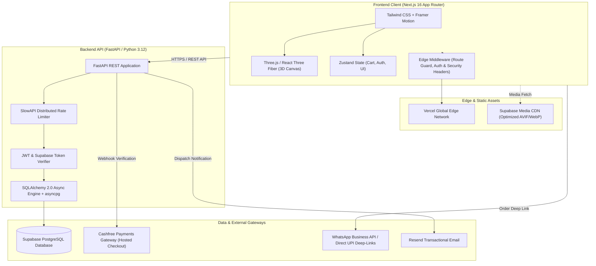

<div align="center">

# 🌲 Dridha Crafts — Handmade in the Kashmir Valley

**A high-performance, artisanal e-commerce platform & 3D product showcase for sustainable pine wood desk accessories.**

[](https://dridhacrafts.vercel.app/)
[](https://nextjs.org/)
[](https://fastapi.tiangolo.com/)
[](https://www.typescriptlang.org/)
[](https://python.org)
[](https://supabase.com)
[](https://threejs.org/)
[](https://github.com/General-Manfredi/Dridha_Crafts/actions)

<br />

[Explore Live Storefront](https://dridhacrafts.vercel.app/) • [Architecture](#-system-architecture) • [Key Engineering Highlights](#-key-engineering-highlights) • [Admin Operations Hub](#-super-admin-operations-hub) • [Local Setup](#-getting-started)

</div>

---

## 🌟 Executive Summary

**Dridha Crafts** is a full-stack, enterprise-grade e-commerce application crafted for an artisan workshop in the Kashmir Valley. We transform naturally fallen Himalayan pine trees into minimalist, heirloom desk accessories with zero deforestation.

Beyond traditional retail, the application features a bespoke **WebGL 3D Interactive Product Atelier**, a **dual-engine checkout system** (Cashfree Payment Gateway + Direct WhatsApp UPI), and a reactive **Super Admin Operations Dashboard** featuring an end-to-end artisan order dispatch pipeline.

---

## 🌐 Live Production Deployment

* **Production URL**: [https://dridhacrafts.vercel.app/](https://dridhacrafts.vercel.app/)
* **Frontend Infrastructure**: Vercel Edge Network (Global CDN, Turbopack, SSR + ISR)
* **Backend Infrastructure**: Render PaaS (FastAPI async microservice)
* **Database & Storage**: Supabase (PostgreSQL 15, Auth, Storage CDN)

---

## 🏗 System Architecture



---

## ⚡ Key Engineering Highlights

### 1. Interactive 3D Product Visualizer (Three.js & React Three Fiber)
* **Real-time WebGL Rendering**: Photorealistic 3D product previews (such as the *Dropzone Tray* and *Bespoke Desk Caddy*) directly inside browser viewports.
* **Optimized Asset Pipeline**: Procedural wood grain shaders, soft shadows, studio lighting rigs, dynamic orbit controls with damping, and smooth responsive canvas sizing without layout shift.
* **Progressive Loading**: Graceful fallbacks and skeleton placeholders ensuring zero impact on Core Web Vitals (LCP, CLS).

### 2. Dual-Engine Checkout Infrastructure
* **Cashfree Payment Gateway Integration**:
  - Secure server-side order token generation via Cashfree PG SDK.
  - Hosted checkout modal with native UPI intent, NetBanking, credit/debit cards, and digital wallets.
  - Webhook listener with **SHA256 HMAC signature verification** and replay protection to prevent duplicate fulfillment.
* **Direct WhatsApp UPI Flow**:
  - Instant mobile-first fallback for regional buyers.
  - Generates tamper-proof order payloads encoded with order IDs, SKU breakdowns, and direct UPI QR prompts.

### 3. Inventory Reservation & Self-Healing Database
* **Concurrent Stock Protection**: 15-minute temporary reservation lock created at order checkout to eliminate race conditions during high-demand drops.
* **Background Reconciler**: Non-blocking worker (`reservation_expiry_worker`) running periodically to release expired holds back to public inventory.
* **Self-Healing Schema Verifier**: On startup, FastAPI validates composite indexes and missing tracking columns dynamically without requiring manual downtime.

### 4. Enterprise Security & IDOR Mitigation
* **Row-Level User Isolation**: Strict ownership gating across all user endpoints (`/api/orders`, `/api/cart`, `/api/wishlist`, `/api/addresses`).
* **Input Injection Guard**: Pydantic v2 schemas configured with `model_config = {"extra": "forbid"}` to strictly reject unexpected attributes or privilege escalation attempts (`role="admin"`).
* **Timing-Attack Resistance**: Constant-time token and secret comparisons using Python's `secrets.compare_digest`.
* **Strict Content Security Policy (CSP)**: Hardened headers with `frame-ancestors 'none'`, nosniff, and strict origin restriction.

---

## 🎛 Super Admin Operations Hub

Located at `/admin` (strictly protected by server-side edge middleware and backend role inspection), the admin panel provides complete operational control:

| Tab | Capabilities |
| :--- | :--- |
| **📈 Live Pulse** | Dynamic time-filtered telemetry (`Today`, `7 Days`, `30 Days`, `All Time`), real-time gross revenue, Cashfree vs. UPI distribution, Average Order Value (AOV), low-stock alerts, and live activity ticker. |
| **📦 Orders Pipeline** | Multi-stage Kanban lifecycle: `Needs Verification` ➔ `Artisan Crafting` (Srinagar Workshop) ➔ `Ready to Pack` ➔ `Shipped` ➔ `Delivered`. Integrated one-click WhatsApp customer contact. |
| **🚚 Courier Dispatch** | Automated modal with carrier integration (Delhivery, Blue Dart, India Post, DTDC, Trackon), AWB tracking number assignment, and live customer transit notes. |
| **👥 Customer Directory** | Customer lifetime value (LTV), total orders, order history inspection, and safe cascade deletion synchronized with Supabase Auth. |
| **🪵 Inventory Control** | Real-time stock decrementing, batch replenishment, price overrides, and SKU status toggles. |

---

## 🛠 Tech Stack Specification

### Frontend
- **Framework**: [Next.js 16 (App Router)](https://nextjs.org/)
- **Language**: TypeScript 5 (Strict Mode)
- **Styling**: Tailwind CSS, PostCSS, Lucide Icons
- **3D Graphics**: Three.js, `@react-three/fiber`, `@react-three/drei`
- **Animations**: GSAP 3, ScrollTrigger, Framer Motion, Lenis Smooth Scroll
- **State Management**: Zustand (Local Storage Persisted Carts & Wishlists)
- **Forms & Validation**: React Hook Form, Zod

### Backend
- **Framework**: [FastAPI 0.115](https://fastapi.tiangolo.com/) (Asynchronous ASGI)
- **Language**: Python 3.12
- **ORM & Database**: SQLAlchemy 2.0 (Asyncio) + `asyncpg` driver
- **Authentication**: Supabase Auth (JWT verification, role claims)
- **Rate Limiting**: SlowAPI with IP-bucket throttling
- **Image Processing**: Pillow

### Database & DevOps
- **Database**: PostgreSQL 15 on Supabase
- **Continuous Integration**: GitHub Actions (3-tier parallel verification pipeline)
- **Hosting**: Vercel (Frontend SSR/Edge), Render (FastAPI Docker runtime)

---

## 📂 Repository Structure

```
dridhacrafts/
├── .github/
│   └── workflows/
│       └── ci.yml               # Automated CI pipeline (Audit, Backend, Frontend)
├── backend/
│   ├── app/
│   │   ├── middleware/          # Auth, CORS, Request ID, Rate limiter
│   │   ├── models/              # SQLAlchemy declarative models (Order, Product, etc.)
│   │   ├── routers/             # API routes (products, orders, payments, admin, auth)
│   │   ├── schemas/             # Pydantic v2 validation contracts
│   │   ├── services/            # Cashfree PG, Email, Notification services
│   │   └── utils/               # Security, token verification, cache helpers
│   ├── tests/                   # Pytest suite (Smoke, schemas, mock gateways)
│   ├── create_admin.py          # Secure admin provisioning & password CLI
│   ├── requirements.txt         # Production Python dependencies
│   └── README.md                # Dedicated Backend Documentation
├── frontend/
│   ├── src/
│   │   ├── app/                 # Next.js App Router (shop, story, checkout, admin)
│   │   ├── components/
│   │   │   ├── 3d/              # Three.js R3F Canvas components & scenes
│   │   │   ├── admin/           # Admin modular views & metric cards
│   │   │   ├── layout/          # Navbar, Footer, Navigation overlays
│   │   │   └── providers/       # Supabase AuthProvider, Global Toast
│   │   ├── hooks/               # Custom hooks (scroll animations, hydration)
│   │   ├── lib/                 # API client, Cashfree SDK loader, Supabase client
│   │   └── stores/              # Zustand state stores (cartStore, authStore)
│   ├── package.json             # Frontend dependencies & scripts
│   └── README.md                # Dedicated Frontend Documentation
├── supabase/
│   └── migrations/              # Production SQL migrations & composite indexes
├── docs/                        # Architecture specs, security audits, plans
├── GEMINI.md                    # Workspace conventions & Git hygiene constraints
└── README.md                    # Root Documentation
```

---

## 🚀 Getting Started

### Prerequisites
* **Node.js**: `v20.x` or higher
* **Python**: `3.11` or `3.12`
* **Package Manager**: `npm`
* **Database**: Active Supabase project (PostgreSQL)

---

### 1. Repository Setup

```bash
git clone https://github.com/General-Manfredi/Dridha_Crafts.git
cd Dridha_Crafts
```

---

### 2. Backend Setup

```bash
# Create and activate virtual environment
python -m venv venv

# Windows
.\venv\Scripts\activate
# macOS/Linux
source venv/bin/activate

# Install dependencies
cd backend
pip install --upgrade pip
pip install -r requirements.txt

# Configure environment
cp .env.example .env
# Fill in your DATABASE_URL, SUPABASE_URL, and SERVICE_ROLE_KEY

# Start backend dev server
uvicorn app.main:app --host 127.0.0.1 --port 8000 --reload
```
* Backend API: `http://127.0.0.1:8000`
* Interactive OpenAPI Docs: `http://127.0.0.1:8000/docs`

---

### 3. Frontend Setup

```bash
cd ../frontend

# Install clean dependencies
npm install

# Configure environment
cp .env.example .env.local
# Fill in NEXT_PUBLIC_SUPABASE_URL and NEXT_PUBLIC_SUPABASE_ANON_KEY

# Run development server with Turbopack
npm run dev
```
* Storefront Application: `http://localhost:3000`

---

### 4. Admin Account Provisioning

To create or promote an admin account to access `/admin`:

```bash
cd backend
python create_admin.py create admin@dridhacrafts.com SecurePassword123 "Store Manager"
```

---

## 🧪 Testing & CI/CD Pipeline

The repository enforces quality via automated GitHub Actions on every push and pull request:

```bash
# Frontend Type Checking
cd frontend
npx tsc --noEmit

# Frontend Production Build Test
npm run build

# Backend Syntax & Bytecode Compilation
cd ../backend
python -m compileall app

# Backend Smoke & Integration Tests
pytest -v
```

### GitHub Actions Workflow Jobs:
1. **`security-audit`**: Checks git tracking to ensure no `.env` files or credentials are leaked into the tree.
2. **`backend-check`**: Validates Python bytecode compilation and boots the FastAPI schema engine with mock configurations.
3. **`frontend-check`**: Runs clean `npm ci`, strict TypeScript typecheck, and the full Next.js production compiler.

---

## 📜 Environmental Commitment

Every Dridha Crafts product is carved exclusively from **naturally fallen pine wood** in Kashmir's mountain forests. No standing trees are ever felled for commercial production. 

---

## 📄 License & Intellectual Property

Private and Proprietary. All rights reserved © 2026 **Dridha Crafts**.  
Handcrafted in the Kashmir Valley.
